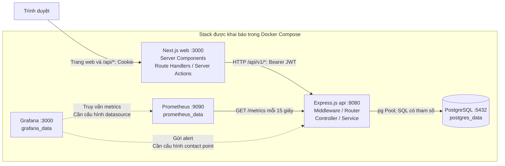

# Kiến trúc hệ thống hiện tại

## 1. Phạm vi và cơ sở xác minh

Tài liệu được đối chiếu với source code tại commit `c44299e` của `senior-platform-repo`. Các trạng thái được phân biệt như sau:

| Trạng thái | Ý nghĩa và mức độ xác minh |
|---|---|
| Đã có source code hoặc cấu hình | Tìm thấy implementation hoặc khai báo trong repository; chưa đủ để kết luận tính năng đã chạy thành công. |
| Đã kiểm thử thành công | Cần kết quả kiểm thử cụ thể gắn với phiên bản và môi trường. Có test file hoặc CI workflow không đồng nghĩa tests đã chạy thành công; kết quả kiểm thử ứng dụng hiện chưa được xác minh. |
| Đã triển khai và vận hành | Cần bằng chứng deployment và hoạt động thực tế tại môi trường xác định. Trạng thái này hiện chưa được xác minh cho các service trong tài liệu. |
| Mới được đề xuất | Có trong roadmap hoặc là phương án thiết kế cần xem xét; chưa có bằng chứng tích hợp trong repository hiện tại. |

Thông tin “đã thực hành ở project riêng” được ghi nhận riêng theo nguồn người dùng cung cấp, không thay thế bằng chứng tích hợp, kiểm thử hoặc vận hành của repository này. Việc đối chiếu kiến trúc chỉ đọc source, không chạy ứng dụng, migration, tests hoặc kết nối database; không truy cập Railway Production. Kiểm tra cú pháp và render Mermaid chỉ xác minh sơ đồ, không xác minh hoạt động của hệ thống.

Luồng chạy chính được xác định từ `express-senior-demo/package.json`, `tsconfig.json`, Dockerfile và Compose: TypeScript trong `src/` được biên dịch thành `dist/`, sau đó chạy `dist/server.js`. Các file JavaScript ở thư mục gốc Backend là implementation cũ, không phải entrypoint của image hiện tại. Vì vậy, không coi Orders API, `/api/v1/profile`, `/api/v1/admin` hay `helmet()` trong `app.js` là tính năng của Backend đang được cấu hình chạy.

Các đường dẫn bằng chứng dưới đây tính từ thư mục gốc repository. Có thể bắt đầu đối chiếu tại [Compose](../../compose.yaml), [Express application](../../express-senior-demo/src/app.ts), [Next.js API client](../../nextjs-senior-demo/src/lib/api.ts) và [roadmap](../../README.md).

## 2. Các thành phần đã có trong repository

| Thành phần | Vai trò và hiện trạng | Bằng chứng |
|---|---|---|
| Next.js / React / TypeScript | App Router, Server Components, Client Components, Route Handlers và Server Actions; có Login, Dashboard, Admin và User Management. Route Handlers đóng vai trò Backend for Frontend (BFF). | `nextjs-senior-demo/src/app/`, `src/lib/`, `src/services/` |
| Express.js / TypeScript | REST API chia Router → Controller → Service → PostgreSQL connection pool; có Authentication demo, RBAC, health, metrics và alert webhook. | `express-senior-demo/src/app.ts`, `src/routes/`, `src/controllers/`, `src/services/` |
| PostgreSQL | Compose dùng `postgres:17-alpine`, lưu dữ liệu trong named volume `postgres_data`; Backend truy cập bằng thư viện `pg`, không qua ORM. | `compose.yaml`, `express-senior-demo/src/config/db.ts` |
| Docker Compose | Stack gốc có `postgres`, `api`, `web`, `prometheus`, `grafana`; có override DEV và STAGING. Dockerfile dùng nhiều build stage. | `compose*.yaml`, Dockerfile của hai ứng dụng |
| Prometheus | Scrape `http://api:8080/metrics` mỗi 15 giây; lưu vào `prometheus_data`. | `prometheus.yml`, `src/metrics/metrics.ts` của Backend |
| Grafana | Có container, cổng truy cập, cấu hình tài khoản quản trị qua biến môi trường và volume `grafana_data`. Không thấy datasource, dashboard hay alert rule được provisioning trong repository. | `compose.yaml`, danh sách file được Git theo dõi |
| GitHub Actions | Backend có TypeScript check/build, Jest và dependency audit; Frontend có TypeScript check, audit và production build. Workflow STAGING chỉ kiểm tra biến/secret, không deploy. | `.github/workflows/ci.yml`, `staging-env-check.yml` |

Backend Dockerfile dùng Node.js 24; Frontend Dockerfile và CI dùng Node.js 22. Các phiên bản dependency trong `package.json` là ràng buộc cài đặt, không phải bằng chứng về phiên bản runtime đang vận hành.

## 3. Sơ đồ kiến trúc hiện tại

Mũi tên liền thể hiện đường gọi có implementation/cấu hình trong source. Mũi tên nét đứt thể hiện kết nối cần cấu hình thêm, chưa được xác minh từ repository. Backend đã có `POST /api/v1/alerts/webhook`, nhưng sự tồn tại của endpoint không chứng minh Grafana đã gửi alert. Sơ đồ không đưa các thành phần đề xuất Phase 7 vào stack hiện tại.

Frontend không kết nối trực tiếp PostgreSQL. Trong Compose, `API_BASE_URL=http://api:8080` là địa chỉ nội bộ dùng phía server của Next.js; trình duyệt gọi các Route Handler cùng origin.

## 4. Luồng Frontend → Backend API → Database

### Đọc dữ liệu

1. Trình duyệt mở `/dashboard/users`; Next.js Proxy kiểm tra Cookie, còn trang gọi `requireAdmin()` trước khi lấy dữ liệu.
2. Server Component gọi `src/services/usersService.ts`, tiếp đó gọi `src/lib/api.ts::apiFetch()`.
3. `apiFetch()` đọc Access Token từ Cookie, gắn `Authorization: Bearer ...`, tạo `x-request-id`, gọi Express với `cache: "no-store"` và ghi status/thời gian gọi.
4. Express nhận `GET /api/v1/users`; `jwtAuth` xác minh JWT và `requireRole("admin")` kiểm tra quyền trước Controller.
5. Controller gọi `usersService.getAllUsers()`; Service dùng `pg.Pool` thực hiện `SELECT id, name, email, created_at FROM users ORDER BY id`.
6. Kết quả quay lại theo chiều PostgreSQL → Service → Controller → JSON → Next.js → giao diện. Luồng này chỉ đi qua bước Authentication khi chế độ chạy cho phép; giới hạn Compose được nêu ở mục 5.

### Ghi dữ liệu

Client Components có thể gửi `POST /api/users`, `PUT /api/users/:id`, `DELETE /api/users/:id` tới Next.js Route Handlers; các handler dùng `apiFetch()` chuyển tiếp tới `/api/v1/users` của Express. Các Server Actions trong `src/app/dashboard/users/actions.ts` cũng gọi Express qua `apiFetch()`, rồi `revalidatePath()` và redirect sau khi thành công.

Express áp dụng JWT và RBAC cho toàn bộ Users Router; POST/PUT thêm `validateUser`. Service dùng SQL có tham số `$1`, `$2`, `$3` cho giá trị đầu vào. API trả 201 khi tạo, 200 khi đọc/cập nhật/xóa, 404 khi không tìm thấy User; Global Error Handler ánh xạ PostgreSQL `23505` thành 409 và lỗi ngoài dự kiến thành 500.

### Schema và migration

`001_create_users.sql` khai báo `users(id, name, email, created_at)`, với email UNIQUE. Bảng này không có password hoặc role và không được Authentication Service dùng để đăng nhập. `002_create_orders.sql` khai báo `orders`, `order_items` với Foreign Key và xóa cascade; `003_add_orders_customer_index.sql` thêm index; migration JavaScript tiếp theo thêm `orders.status`. Đây là schema được khai báo, chưa xác nhận đã áp dụng vào database nào. Orders Router chỉ được mount trong bản JavaScript cũ.

Có hai cơ chế migration: `npm run migrate` chạy script SQL riêng, ghi lịch sử vào `schema_migrations`; `npm run migrate:up` gọi `node-pg-migrate` và được Compose chạy trước API. Cần thống nhất cơ chế và kiểm chứng khả năng tạo database từ đầu; không suy ra migration đã thành công chỉ từ health check.

## 5. Authentication, JWT và RBAC

### Authentication và vòng đời token

- Client gửi Login tới Next.js `POST /api/auth/login`; Route Handler chuyển tiếp tới Express `POST /api/v1/auth/login`.
- `src/services/authService.ts` chỉ có một tài khoản demo trong code, kiểm tra password bằng `bcrypt.compare()`; không có tra cứu tài khoản trong PostgreSQL.
- Khi Login thành công ở chế độ cho phép, Backend ký Access Token bằng `JWT_SECRET` với thời hạn 15 phút, Refresh Token bằng `JWT_REFRESH_SECRET` với thời hạn 7 ngày. Payload có `id`, `username`, `role`.
- Next.js giữ token trong Cookie `accessToken`, `refreshToken`, cùng Cookie `userRole`; đều có `httpOnly`, `sameSite: "lax"`, `path: "/"`, nhưng đang đặt `secure: false`. Thời hạn Cookie lần lượt là 15 phút, 7 ngày và 1 giờ.
- Express lưu Refresh Token hợp lệ trong `Set<string>` của process. `/api/v1/auth/refresh` kiểm tra Set và xác minh JWT trước khi cấp Access Token mới, không rotate Refresh Token. `/api/v1/auth/logout` xóa Refresh Token khỏi Set; Access Token đã cấp không bị thu hồi ngay.
- Next.js có `POST /api/auth/refresh` để cấp lại Cookie Access Token và `POST /api/auth/logout` để gọi Backend, xóa ba Cookie. Có endpoint không đồng nghĩa giao diện tự động sử dụng nó.

**Giới hạn quan trọng:** `authService.ts` trả `null` cho Login và Refresh khi `NODE_ENV=production`; `jwtAuth.ts` trả 403 trước khi đọc Bearer Token, kể cả khi không có token hoặc token hợp lệ. `compose.yaml` đặt Backend `NODE_ENV=production`; override DEV/STAGING chỉ thêm `APP_ENV`, không đổi `NODE_ENV`. Code Authentication đọc `NODE_ENV`, không đọc `APP_ENV`. Vì vậy, nếu API khởi động theo cấu hình Compose hiện tại, Login/Refresh có đủ trường bắt buộc vẫn nhận 401 từ Controller, còn Users API bị Middleware chặn với 403. Đây là cơ chế chủ động chặn demo ở Production, không phải Authentication Production đã hoàn thiện. `tests/productionAuth.test.js` có test cho hành vi chặn này, nhưng kết quả chạy tests chưa được xác minh trong đợt tài liệu hóa.

### HTTP 401 và HTTP 403 trong implementation hiện tại

HTTP 401 biểu thị chưa xác thực thành công; HTTP 403 biểu thị truy cập bị từ chối do quyền hoặc chính sách. Với demo này, không thể suy ra rằng mọi response 403 đều đã xác thực thành công: nhánh Production từ chối ngay trước bước xác minh JWT.

| Trường hợp | Response theo source | Bằng chứng |
|---|---|---|
| `NODE_ENV` khác `production`: thiếu Authorization hoặc không có prefix `Bearer ` | 401 `Unauthorized`. | `src/middleware/jwtAuth.ts` của Backend |
| `NODE_ENV` khác `production`: JWT không hợp lệ hoặc hết hạn | 401 `Invalid or expired token`. | `src/middleware/jwtAuth.ts` của Backend |
| `requireRole()` không có `req.user` | 401 `Unauthorized`; trong Users Router, `jwtAuth` chạy trước để xác thực. | `src/middleware/requireRole.ts`, `src/routes/users.ts` của Backend |
| Đã có `req.user` nhưng role không khớp quyền yêu cầu | 403 `Forbidden`. | `src/middleware/requireRole.ts` của Backend |
| `NODE_ENV=production`: request đi qua `jwtAuth` | 403 `Demo authentication is disabled in production`, không phụ thuộc việc có token hay token hợp lệ. | `src/middleware/jwtAuth.ts` của Backend |
| Login có đủ username/password nhưng không xác thực được; Refresh có token nhưng không được chấp nhận | 401 từ Controller; bao gồm khi Service trả `null` do demo bị tắt trong Production. | `src/controllers/authController.ts`, `src/services/authService.ts` của Backend |
| Thiếu username/password khi Login hoặc thiếu Refresh Token khi gọi Backend Refresh | 400 do thiếu trường bắt buộc; riêng Next.js `/api/auth/refresh` trả 401 khi thiếu Cookie Refresh Token. | `src/controllers/authController.ts` của Backend; `nextjs-senior-demo/src/app/api/auth/refresh/route.ts` |

Các status trên mô tả nhánh xử lý trong source, không phải kết quả gọi API thực tế. Login còn có Rate Limiter có thể trả 429 trước Controller.

### RBAC và lớp bảo vệ giao diện

Khi `NODE_ENV` khác `production`, `jwtAuth` đọc Bearer Token, dùng `jwt.verify()` và gán thông tin vào `req.user`. `requireRole("admin")` so sánh role từ JWT; thiếu Authentication trả 401, đã xác thực nhưng sai role trả 403. Trong Production, nhánh chặn demo của `jwtAuth` trả 403 trước các bước này. Toàn bộ CRUD Users đều yêu cầu admin, chưa có permission matrix chi tiết hoặc quản lý role qua database.

Next.js `src/proxy.ts` kiểm tra sự tồn tại của Cookie Access Token cho `/dashboard/*`, `/admin/*`, và dùng Cookie `userRole` để điều hướng `/admin`. `src/lib/guards.ts` cung cấp `requireAuth()` và `requireAdmin()`. Những lớp này chỉ đọc Cookie, không xác minh chữ ký hay hạn JWT; chúng phục vụ điều hướng giao diện. Quyết định cấp quyền truy cập dữ liệu vẫn nằm ở Express dựa trên JWT đã xác minh.

## 6. Middleware và Observability

Thứ tự trong `express-senior-demo/src/app.ts` là CORS → JSON parser → Request ID → Metrics Router → Request Logger → Metrics Middleware → Health Router → Auth/Users/Alerts Routers → Global Error Handler. Backend tin một reverse proxy hop khi `NODE_ENV=production`; các chế độ khác không tin forwarded headers.

| Middleware / endpoint | Hành vi được xác minh |
|---|---|
| `requestId` | Nhận `x-request-id` hoặc sinh UUID, lưu vào `res.locals`, trả lại response header. |
| `requestLogger` | Pino ghi method, URL, status, duration và Request ID; bỏ qua hai health endpoint. |
| `metricsMiddleware` | Ghi Counter `senior_api_http_requests_total` và Histogram `senior_api_http_request_duration_seconds`, label method/route/status; không bỏ qua health request. |
| `GET /metrics` | Xuất metrics qua `prom-client`, gồm default process metrics với prefix `senior_api_`; được mount trước logger/metrics middleware nên không tự đếm lượt scrape. |
| `loginRateLimiter` | Chỉ gắn vào Login: giới hạn 5 lượt trong 15 phút theo IP, bỏ qua lượt thành công; chưa cấu hình shared store. |
| `validateUser` | Kiểm tra name/email có giá trị, là string và email có `@`; dùng cho POST/PUT Users. |
| `errorHandler` | Ghi log theo loại lỗi, che thông tin lỗi ngoài dự kiến bằng thông báo chung. |
| Health | `/health/live` trả trạng thái process; `/health/ready` chạy `SELECT 1`; Next.js `/api/health` chỉ trả trạng thái Web, không gọi Backend. |
| Alert webhook | `/api/v1/alerts/webhook` ghi toàn bộ payload ra console rồi trả 200; chưa có Authentication hoặc xác thực nguồn gửi. |

## 7. Docker Compose và ranh giới môi trường

Stack gốc có CPU/memory limit và restart policy; PostgreSQL dùng `pg_isready`, API kiểm tra `/health/ready`, Web kiểm tra `/api/health`. API chờ PostgreSQL healthy, Web và Prometheus chờ API healthy; Grafana chỉ có `depends_on` Prometheus, không có kiểm tra readiness tương ứng. API đóng HTTP server và PostgreSQL pool khi nhận SIGTERM/SIGINT.

| Môi trường | Cổng host được khai báo |
|---|---|
| Stack gốc | PostgreSQL/API/Web lấy từ biến môi trường; Prometheus 9090, Grafana 3001; không chỉ định địa chỉ loopback. |
| DEV override | Chỉ bind `127.0.0.1`: PostgreSQL 5544, API 8081, Web 3002, Prometheus 9091, Grafana 3003. |
| STAGING override | Chỉ bind `127.0.0.1`: PostgreSQL/API/Web lấy từ biến môi trường, Prometheus 9092, Grafana 3005. |

Override xóa `container_name`, cho phép Compose đặt tên theo project; cần project riêng để tách network/volume giữa môi trường. DEV vẫn dùng production image, không khai báo bind mount source hay hot reload. Các tag `!reset`/`!override` đòi hỏi Docker Compose hỗ trợ. `express-senior-demo/compose.yaml` là stack phụ chỉ có Backend và PostgreSQL, không phải stack đầy đủ năm service; stack phụ không khai báo lệnh chạy migration trước API.

## 8. Vấn đề kỹ thuật cần cải thiện đã xác minh

Các tác động dưới đây được suy ra từ source/configuration, không phải kết quả kiểm thử runtime hoặc quét Production.

| Vấn đề và bằng chứng | Tác động / hướng cải thiện đề xuất |
|---|---|
| Authentication demo bị tắt trong production nhưng cả hai override kế thừa chế độ này (`compose*.yaml`, `src/services/authService.ts`, `src/middleware/jwtAuth.ts`). | Luồng Login/Users không hoạt động theo stack hiện tại. Cần Authentication thực và quy định rõ từng môi trường, giữ nguyên cơ chế chặn demo ở Production. |
| Refresh Token và login rate limit chỉ lưu trong process (`authService.ts`, `loginRateLimiter.ts`). | Restart làm mất phiên refresh; nhiều replica không chia sẻ trạng thái. Cần lưu trữ phiên có TTL, rotation/revocation và shared rate limit store. |
| Cookie đặt `secure: false`; Proxy/guards chỉ đọc Cookie (`src/app/api/auth/`, `src/proxy.ts`, `src/lib/guards.ts` của Frontend). | Cần Cookie Secure cho HTTPS và xác minh session ở server; không dùng Cookie role làm bằng chứng cấp quyền dữ liệu. |
| Luồng Users đang dùng `apiFetch()`, không refresh khi 401; `authenticatedFetch.ts` không có nơi import/gọi và không cập nhật Cookie sau refresh. | Chưa có tự động refresh nhất quán. Khi Cookie Access Token hết hạn, Proxy chuyển về Login dù Refresh Token còn hạn; cần hoàn thiện vòng đời phiên và xử lý lỗi. |
| Tests Auth/Users import `../app` JavaScript cũ, trong khi Docker chạy `dist/server.js`; các tests productionAuth/errorHandler mới dùng `dist/`. | CI có thể xanh mà chưa xác minh luồng CRUD/RBAC của ứng dụng TypeScript. Cần đưa integration tests về cùng entrypoint runtime. |
| Hai migration runner dùng cơ chế lịch sử khác nhau; SQL cũ không có khối Up/Down của `node-pg-migrate`, còn migration JS chỉ thêm cột (`migrations/`, `scripts/runMigrations.js`, `package.json`). | Chưa đủ cơ sở khẳng định bootstrap database trống thành công bằng lệnh Compose. Cần chuẩn hóa runner/định dạng và kiểm thử trên database tạm biệt lập. |
| `helmet` chỉ được mount trong `app.js` cũ, không có trong `src/app.ts`. | Không thể coi security headers của Helmet là đã áp dụng cho runtime hiện tại; cần cấu hình và kiểm chứng trên entrypoint thực. |
| Metrics và alert webhook không có bảo vệ ở application; webhook ghi toàn bộ payload (`src/routes/metrics.ts`, `alerts.ts`). | Cần giới hạn truy cập metrics, xác thực webhook và chọn lọc dữ liệu log; không dựa vào CORS để bảo vệ endpoint. |
| Grafana chưa có provisioning; Prometheus/Grafana dùng tag `latest` (`compose.yaml`, danh sách file). | Dashboard/alert không tái lập được từ repository; cần lưu provisioning và cố định phiên bản image. |
| Users list không phân trang; validation chỉ kiểm tra email có `@`, chưa kiểm tra độ dài theo schema (`usersService.ts`, `validateUser.ts`, `001_create_users.sql`). | Dữ liệu tăng sẽ làm response lớn; dữ liệu vượt giới hạn có thể thành lỗi 500. Cần pagination và validation thống nhất với schema. |

## 9. Phân biệt hiện trạng và đề xuất Phase 7

Repository hiện không có tài liệu xác định phạm vi mang tên “Phase 7”. `README.md`, mục Roadmap, chỉ đề xuất CAD/BOM ingestion, semantic search và RAG cùng các cải tiến CI/testing/cloud/CD. Vì vậy, bảng dưới là phân loại phục vụ thảo luận Phase 7, không phải xác nhận roadmap Phase 7 đã được phê duyệt.

| Thành phần / năng lực | Trạng thái xác minh |
|---|---|
| Next.js, Express.js, PostgreSQL, JWT/RBAC demo, Docker Compose, metrics Prometheus, container Grafana | Đã có source code hoặc cấu hình; còn các giới hạn nêu trên. Chưa xác minh kiểm thử ứng dụng thành công hoặc deployment và vận hành thực tế. |
| CAD/BOM ingestion, semantic search, RAG | Chỉ được nêu trong roadmap; chưa thấy implementation, endpoint hoặc service Compose tương ứng. Có thể đề xuất cho Phase 7. |
| Python ETL | Theo thông tin người dùng cung cấp, đã được thực hành ở các project riêng; chưa được xác minh trong repository hiện tại. Không tìm thấy file Python hoặc service/pipeline ETL trong danh sách file được Git theo dõi; quy tắc Python trong `.gitignore` không phải implementation. Tích hợp vào repository này mới là phương án đề xuất. |
| pgvector | Theo thông tin người dùng cung cấp, đã được thực hành ở các project riêng; chưa được xác minh trong repository hiện tại. Không thấy dependency, migration `CREATE EXTENSION`, kiểu vector hoặc truy vấn vector. PostgreSQL hiện tại không đồng nghĩa đã tích hợp pgvector; tích hợp mới là phương án đề xuất. |
| Chroma | Theo thông tin người dùng cung cấp, đã được thực hành ở các project riêng; chưa được xác minh trong repository hiện tại. Không thấy dependency, client hoặc service Compose; tích hợp làm vector store mới là phương án đề xuất. |
| Ollama | Theo thông tin người dùng cung cấp, đã được thực hành ở các project riêng; chưa được xác minh trong repository hiện tại. Không thấy client, model configuration hoặc service Compose; tích hợp phục vụ model mới là phương án đề xuất. |

Thông tin thực hành Python ETL, pgvector, Chroma và Ollama ở các project riêng do người dùng cung cấp chưa được đối chiếu với source hoặc kết quả kiểm thử/vận hành của các project đó. Không có bằng chứng để vẽ chúng như thành phần đã tích hợp trong repository hiện tại. Việc chọn pgvector hay Chroma, có dùng Ollama hay không, hợp đồng ingestion và thiết kế RAG cần được quyết định trong thiết kế Phase 7 riêng. Tài liệu này không khẳng định trạng thái Railway Production và không dùng ghi chú Railway trong source để suy ra deployment thực tế.
