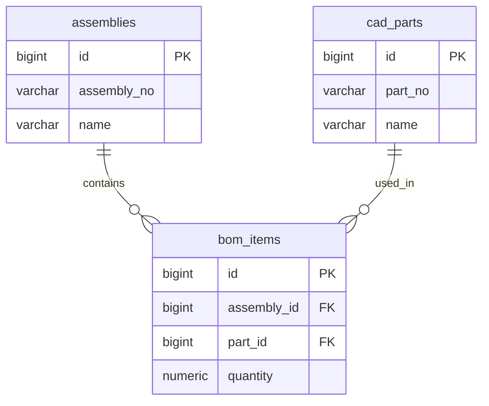

# CAD/BOM Platform — Database Design v1

## 1. Purpose

Design the database domain for managing CAD
parts, assemblies, and Bill of Materials (BOM).

PostgreSQL is the source of truth.

## 2. Core Entities

### assemblies
Represents an engineering assembly.

Candidate fields:
- id (PK)
- assembly_no (business identifier)
- name
- created_at
- updated_at

### cad_parts
Represents an individual CAD component.

Candidate fields:
- id (PK)
- part_no (business identifier)
- name
- description
- created_at
- updated_at

### bom_items
Represents a component used in an assembly.

Candidate fields:
- id (PK)
- assembly_id (FK)
- part_id (FK)
- quantity
- line_number (optional)

## 3. Entity Relationship Diagram

## 4. Business Rules

- One assembly contains zero or more BOM items.
- One CAD part can belong to multiple assemblies.
- Each BOM item references one assembly and one part.
- Quantity must be greater than zero.
- Parts and assemblies require stable identifiers.
- Re-importing a BOM must avoid unintended duplicates.
- BOM synchronization must handle removed items.

## 5. Design Decisions To Verify

- Actual column names and types from Phase 4
- Primary keys and foreign keys
- Unique constraints for BOM lines
- Quantity precision
- BOM revision and versioning
- Deletion and synchronization policies
- Indexes for part and assembly lookup

## 6. Existing Components To Reuse

- Python ETL
- cad_motors_repository
- BOM synchronization
- GET_BOM
- PostgreSQL
- Express REST API

## 7. Current Status

Architecture draft only.

CAD/BOM database schema has not yet been
restored on Mac.

Verify the original Phase 4 schema before
creating any CAD/BOM migrations.
